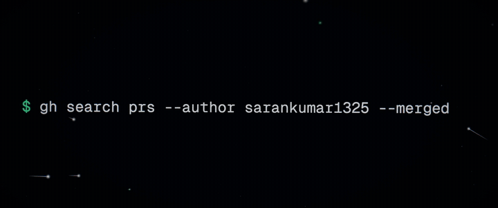

<div align="center">

# Open-source, live.

**Your merged pull requests, turned into a cinematic, live portfolio.**<br>
Type any GitHub username and watch their open-source work come alive. Or fork it and make it yours.

<a href="docs/media/oss-showcase-film.mp4"></a>

**[▶ Watch the 30-second film, with sound](docs/media/oss-showcase-film.mp4)**

[](https://sarankumar1325.github.io/oss-showcase/)
[](https://github.com/sarankumar1325/oss-showcase/actions/workflows/deploy.yml)
[](LICENSE)


**[Live demo](https://sarankumar1325.github.io/oss-showcase/)** · **[See yours](#see-yours-in-10-seconds)** · **[Make it yours](#make-it-yours-fork-in-3-steps)**

</div>

---

## See yours in 10 seconds

Open this link with your GitHub username at the end:

```
https://sarankumar1325.github.io/oss-showcase/?u=YOUR_GITHUB_USERNAME
```

Or press **See yours** in the site's top bar and type it in. No sign-in, no install, no token. Your whole history loads live from GitHub in your browser.

## What you get

- **An opening shot.** Every merged PR becomes a streak of light, landing on one point in the order it merged.
- **Orbit.** Every repository you've contributed to is a star. Bigger means more merges.
- **Rhythm.** Daily merges, a contribution calendar and the hours you ship, in 2D. **Flip any chart to 3D** and orbit it.
- **Live feed.** It checks GitHub every minute, so a new merge ripples across the page while you watch.
- **Archive.** Every merged PR with search, filters, sorting and pagination, all in shareable URLs.
- **Made to share.** A link-preview card generated for your profile, plus one-click share.

Only **public**, **merged** pull requests into repositories **you don't own** count. Nothing is invented.

## Three ways to use it

| | How | Token? |
| --- | --- | --- |
| **See anyone's** | `?u=username` on the live site | Not needed |
| **Make it yours** | Fork, edit one file, deploy to GitHub Pages | Not needed (Actions has its own) |
| **Go faster** | Paste a fine-grained token in the site's *Optional token* sheet | Optional, read-only |

---

## Make it yours (fork in 3 steps)

1. **Fork** this repository.
2. **Edit `portfolio.config.ts`**: your GitHub username, name, photo (or `null` for your GitHub avatar) and time zone. Put a photo file in `public/` if you use one.
3. **Turn on Pages**: in your fork, go to Settings → Pages → Source and choose **GitHub Actions**. Then push, or run the *Deploy* workflow by hand.

The workflow in `.github/workflows/deploy.yml`:
- runs `bun run snapshot` with GitHub's **built-in** `GITHUB_TOKEN`, so there is no secret to create,
- renders your link-preview card (`bun run og`),
- builds the site with your title, description and preview tags,
- publishes it to Pages,
- runs again every 6 hours so new merges land without a push.

Until the first snapshot is generated, the site loads your data live in the browser instead. A fork works even before the workflow has run.

### Config options

| Key | What it does |
| --- | --- |
| `github` | Your username. Everything is built from it |
| `name` | Display name in the hero and footer |
| `photo` | A file in `public/`, an `https://` URL, or `null` for your GitHub avatar |
| `timeZone` / `timeZoneLabel` | IANA zone used for days and hours, plus an optional short label like `IST` |
| `excludeOwners` | Owners whose repos shouldn't count, such as your employer's org |
| `includeOwnRepos` | Also count PRs merged into your own repositories |
| `allowViewer` | Let visitors open other people's portfolios with `?u=` |
| `sourceRepo` | `owner/repo` for the *Fork this site* button. Leave `null` and Actions fills it in |

---

## Tokens, honestly

You don't need one. Everything shown is public. A token only raises GitHub's rate limits:

| | No token | With a token |
| --- | --- | --- |
| Searches | 10 / minute | 30 / minute |
| Other requests | 60 / hour | 5,000 / hour |

- **Browsing with `?u=`:** for big histories, paste your own token in the site's *Optional token* sheet. Create a **fine-grained** personal access token with **public repositories (read-only)** access and **no permissions** selected; the sheet links to a prefilled page. It stays in your browser (session-only unless you tick "remember") and is sent only to `api.github.com`.
- **Deploying:** the workflow uses the built-in Actions token. Never put a token in a `VITE_*` variable, because Vite bakes those into the public JavaScript.
- **Locally:** `GITHUB_TOKEN=… bun run snapshot` is faster, but `bun run snapshot` works without one.

---

## Run locally

```bash
bun install
bun run dev        # http://localhost:5173
bun run snapshot   # refresh src/data/snapshot.json from GitHub
bun run og         # render public/og-<username>.png, the link-preview card
bun run build      # typecheck + production build into dist/
bun run preview    # serve the production build
```

## URL flags

| Flag | Effect |
| --- | --- |
| `?u=<username>` | Show someone else's portfolio, loaded live in the browser |
| `?skip` | Skip the opening sequence |
| `?demo` | Replay the 4 newest real merges one at a time, to preview the live experience offline |

## Sharing

- **Link previews** (Slack, X, LinkedIn, WhatsApp) show a 1200×630 card. It has the count, repositories, name, photo and an activity chart, rendered at build time by `scripts/og.tsx`. Crawlers don't run JavaScript, so previews always describe the deployment's owner. A `?u=` link previews as the site owner's card, while its tab title and icon show the person being viewed.
- **Share** in the footer copies a clean link to the portfolio on screen (or opens the share sheet on phones).
- **Fork this site** appears once the repo is known (automatic on GitHub Actions).

## Pages

- `#/`: the overview
- `#/contributions`: the full archive. It has search, owner and repo filters, sort, page size, group by day, pagination and ←/→ keys. Filters live in the URL, so any view is shareable.

## How the data flows

1. **Your own site:** `src/data/snapshot.json` is generated at build time for the configured user, then the browser polls GitHub search every 60 s for new merges.
2. **`?u=` or a fresh fork:** the browser loads the full history live, splitting by date past GitHub's 1,000-results-per-search cap. It waits out rate limits with a visible countdown and caches the result in `localStorage`, so the next visit opens instantly.
3. **Owner types** (organization or individual) are resolved in a single GraphQL call when a token is available. Otherwise they are looked up one at a time within the hourly budget and shown as "resolving" until known.

Nothing is invented: if GitHub is unreachable or rate-limited, what is on screen simply stays.

## The film is code too

The launch film at the top is not edited footage. It's a hand-written three.js scene in [`film/`](film/), with real data, bloom, film grain and a 2.39:1 letterbox. Every frame is rendered on the GPU and streamed into ffmpeg, and the score is synthesized from scratch in Node.

```bash
cd film && bun install
node scripts/score.mjs     # synthesize the score
node scripts/render.mjs    # render 900 frames → out/oss-showcase-film.mp4
bunx vite                  # live preview: space to pause, ←/→ to scrub, ?t=12.5 to jump
```

## Structure

- `portfolio.config.ts`: the one file a fork edits
- `scripts/snapshot.ts`: builds the snapshot (Bun)
- `src/Boot.tsx`: decides owner vs `?u=`, and snapshot vs cache vs live load
- `src/lib/github.ts`: the small GitHub client shared by the browser and the script
- `src/lib/profile.ts`, `token.ts`, `cache.ts`: who is shown, the optional token, the browser cache
- `src/components/Loader.tsx`, `TokenSheet.tsx`, `ViewAnother.tsx`: live loading, the token sheet, the username box
- `src/components/*`: intro, orbit, rhythm (2D/3D), feed, ledger, archive, cursor and transitions
- `film/`: the launch film (three.js, GPU render, synthesized score)

Respects `prefers-reduced-motion`.

## License

MIT. Fork it, make it yours.
